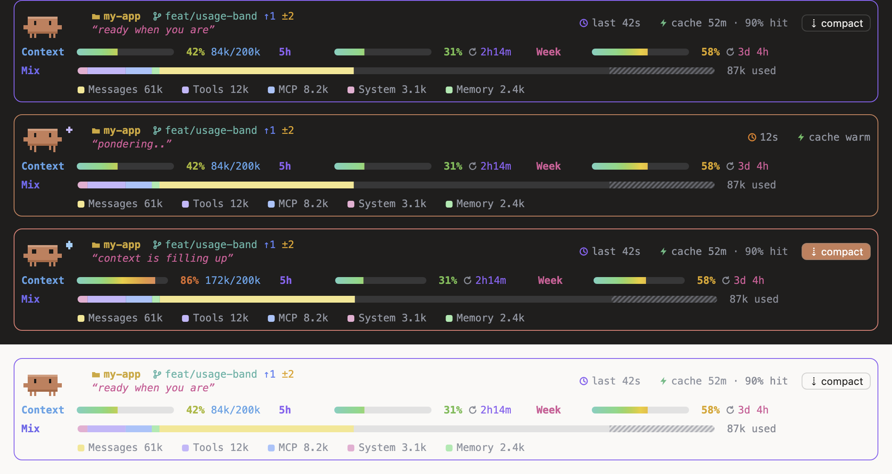
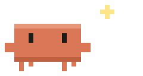

# usage-band

A small card above the Claude Code prompt that tells you, at a glance, how much room you have left. It shows context fill, your 5-hour and weekly usage limits, what fills the context window, how warm the prompt cache is, and which folder and branch you're on. Claudie, a little pixel Claude, keeps you company and reacts to what the session is doing.



<p align="center"></p>

## Install

At the prompt of a Claude Code terminal session:

```
/plugin install usage-band --marketplace pawel-mazurkiewicz/usage-band
```

Answer `y` to add the marketplace, then press Enter to install at the user scope, so the band shows in every session.

From a shell:

```bash
claude plugin install usage-band --marketplace pawel-mazurkiewicz/usage-band
```

In the Claude desktop app, where `/plugin` doesn't run: click **+** next to the prompt box, choose **Plugins**, then **Add marketplace** with `pawel-mazurkiewicz/usage-band`, then **Add plugin**. A plugin installed from a terminal at the user scope also loads in the desktop app's Code tab.

## What it shows

| | |
|---|---|
| **Context** | How full the context window is, with tokens used out of the window. |
| **5h / Week** | Your subscription's 5-hour and weekly usage, each with a countdown to its reset. Only shown on a subscription. |
| **Mix** | The context split by category (system prompt, tools, MCP, memory, messages…), with the auto-compact reserve hatched at the end. |
| **Folder and branch** | The session's folder, its git branch, commits ahead and behind (`↑1 ↓2`) and changed files (`±3`). |
| **Turn time** | A live timer while Claude works, then how long the last turn took. |
| **Cache** | How long the prompt cache stays warm after the last turn, and that turn's cache hit rate. Shows `cache cold` once it has expired. |
| **Compact** | A button that runs `/compact`. It's highlighted once context passes 70%. |

The bars run along a heat ramp from teal through green, amber and orange to red, so a glance tells you how close you are.

## Claudie

| Mood | When |
|---|---|
| Working | A turn is running: she hops, and sparkles drift by. |
| Happy | A turn just finished. |
| Booped | You clicked her (desktop): she hops with a heart. |
| Worried | Context is above 80%, or a usage limit is nearly used up: wide eyes and a sweat drop. |
| Sleeping | Nothing has happened for 10 minutes. |
| Compacting | The conversation is being compacted: she squishes. |
| Idle | Otherwise: she blinks and looks around. |

The card's border colour follows her mood.

## Settings

| Option | Default | |
|---|---|---|
| `cacheTtlMinutes` | `60` | How long the prompt cache stays warm after a turn. Use `60` on a Pro or Max subscription and `5` with an API key. |

Change it from the plugin's settings, or at install time with `--config cacheTtlMinutes=5`.

The engine doesn't report when the cache expires, so the cache countdown assumes it started when the last turn ended.

## How it draws

- **Desktop:** the desktop's text has no monospaced face, so each row is drawn as an SVG image set in the system's monospaced font. Every piece of text sits at a measured position, so columns line up to the pixel in either theme. Claudie is pixel art whose frame changes every 250 ms.
- **Terminal:** the band is plain text, sized to the terminal's width. Claudie is Claude Code's own logo in block characters. On narrow terminals she hides first, then the bars, then the less important details.

## Develop

```bash
claude plugin validate .
claude plugin test .
```

Run a session with the plugin loaded from this folder:

```bash
claude --plugin-dir .
```

- `hooks/register.tsx`: the data hooks and both layouts.
- `hooks/desktop.ts`: the SVG rows.
- `hooks/claudie.ts`: Claudie's sprite and moods.
- `types/index.d.ts`: the state the band keeps.

## Credits

The pixel pet drawn as SVG frames, and the clickable pet, were inspired by [ctxline-claude](https://github.com/MithunWijayasiri/ctxline-claude).
